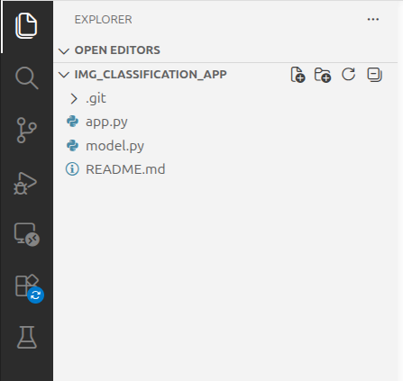
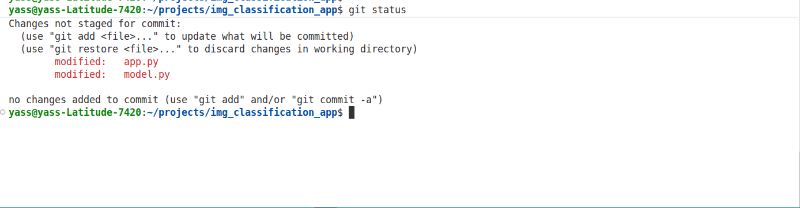
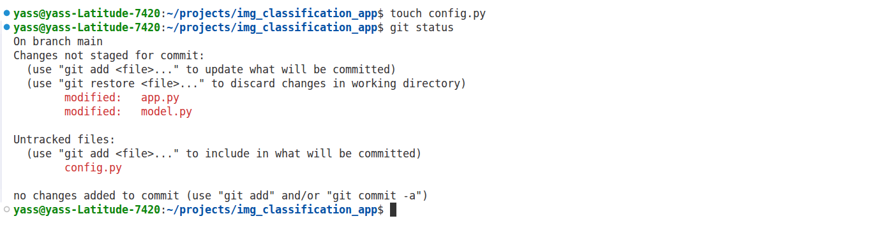
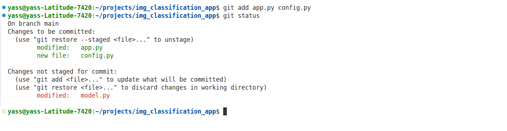
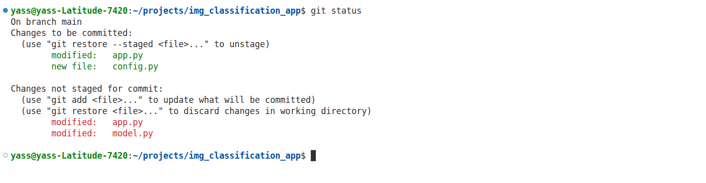
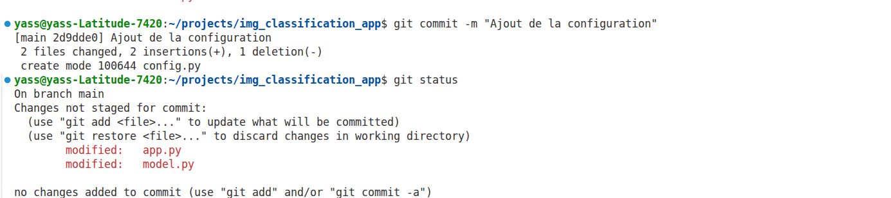
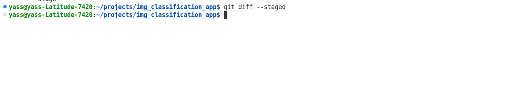
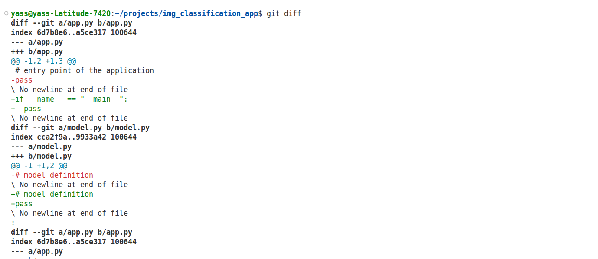

# Compte rendu de l'exercice 1 : Git

## Objectif

Montrer l'enchaînement des étapes Git : modification, staging, commit et vérification des différences.

Le dépôt contient initialement :

- app.py
- model.py
- README.md

Les captures 01_step1 à 01_step5 illustrent précisément l'ordre des actions :

1. modification de app.py et model.py
2. création de config.py
3. git add app.py config.py
4. nouvelle modification de app.py
5. git commit -m "Ajout de la configuration"



---

## 1. État des fichiers après l'étape 1

- app.py : modifié mais non ajouté
- model.py : modifié mais non ajouté
- README.md : inchangé



## 2. État des fichiers après l'étape 2

Le fichier config.py vient d'être créé, mais il n'est pas encore ajouté à l'index.



---

## 3. Zone de préparation après l'étape 3

Commande :

```bash
git add app.py config.py
```

Après cette commande, dans la zone de préparation on trouve :

- la version modifiée de app.py
- le fichier config.py

La modification de model.py n'est pas ajoutée.



---

## 4. Pourquoi app.py apparaît dans les deux sections après l'étape 4

Après le git add, app.py est déjà dans l'index. Puis on modifie app.py une deuxième fois sans refaire `git add`.

Résultat :

- dans la zone de préparation : ancienne version de app.py
- dans le dossier de travail : nouvelle version de app.py

Donc `git status` affiche app.py dans deux sections :

- Changes to be committed
- Changes not staged for commit



---

## 5. Ce qui est inclus dans le commit

Commande :

```bash
git commit -m "Ajout de la configuration"
```

Le commit contient uniquement :

- la version de app.py ajoutée au stage
- le fichier config.py

Ce qui reste hors du commit :

- la deuxième modification de app.py
- model.py, jamais ajouté



---

## 6. Commandes pour voir les changements

### Modifications préparées

```bash
git diff --cached
```

ou

```bash
git diff --staged
```

Cette commande permet d'afficher les changements déjà ajoutés dans la zone de staging.



Aucune sortie, ce qui est logique, puisqu'il n'existe aucun fichier ajouté a la zone de staging.

### Modifications non préparées

```bash
git diff
```

Cette commande permet d'afficher les changements encore présents dans le dossier de travail, c'est-à-dire les fichiers non ajoutés au staging.



---

## Conclusion

L'exercice montre bien que Git sépare trois zones :

- le dossier de travail
- la zone de staging
- le commit

Une modification n'est enregistrée dans le commit que si elle a été ajoutée avec `git add`.

De plus, un fichier peut être présent à la fois dans l'index et dans le dossier de travail avec des versions différentes, ce qui explique le cas de app.py après l'étape 4.

---

## Annexes

- [assets/01_initial_project_stucture.png](assets/01_initial_project_stucture.png)
- [assets/01_step1.png](assets/01_step1.png)
- [assets/01_step2.png](assets/01_step2.png)
- [assets/01_step3.png](assets/01_step3.png)
- [assets/01_step4.png](assets/01_step4.png)
- [assets/01_step5.png](assets/01_step5.png)
- [assets/01_git_diff.png](assets/01_git_diff.png)
- [assets/01_git_diff_staged.png](assets/01_git_diff_staged.png)
